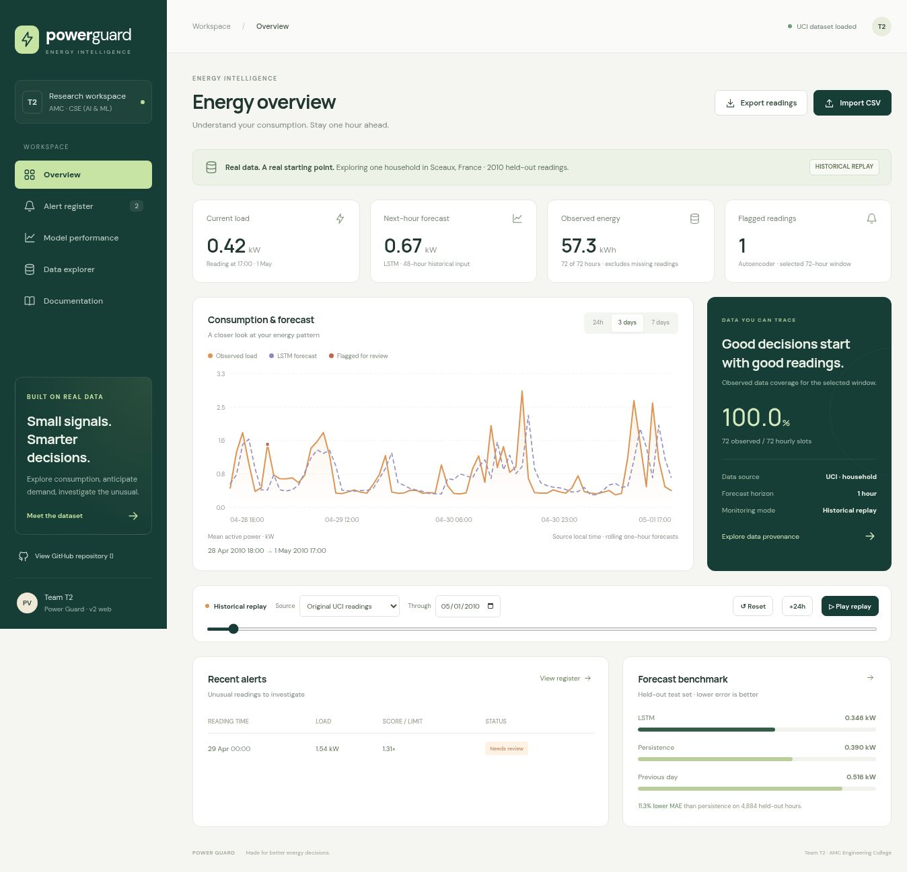
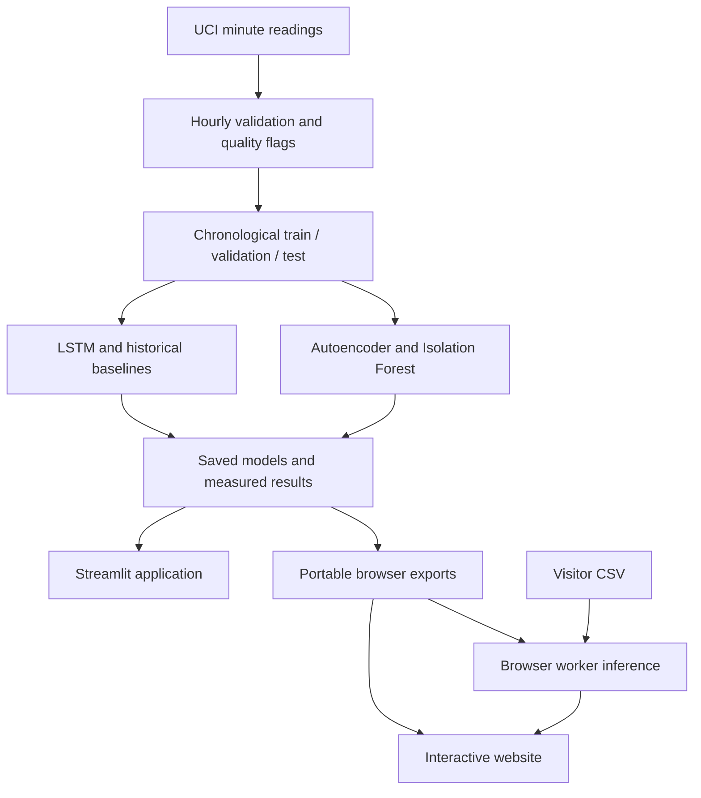

# Power Guard

**AI-driven micro-grid energy load forecasting and anomaly detection for urban apartments.**

[Open the working website](https://power-guard-energy.vishalravi20k.chatgpt.site) · [Web guide](docs/WEB_GUIDE.md) · [Evaluation](reports/EVALUATION.md) · [Local Python setup](docs/LOCAL_SETUP.md)

Power Guard turns real hourly electricity readings into next-hour forecasts and reviewable anomaly alerts. The website works without a Python installation and performs uploaded-data inference on the visitor's device. The original Streamlit application and reproducible Python training pipeline are included.

The hosted website is **public**: anyone with the link can open it without signing in. This repository is also public. GitHub changes do not automatically redeploy the Sites website.



## What works

- Location monitoring: assign uploaded meter files to localities/GPS pins, compare timestamped forecasts and review evidence, and export a location report. Location metadata is user-provided; this is not a citywide outage or safe-route map.

- Responsive dashboard with actual kW readings, a true next-hour LSTM prediction, observed energy estimates in kWh, and quality coverage.
- Historical replay with dates, time windows, play/pause, reset and advance controls.
- Original UCI readings and a separately labelled controlled injected-event challenge.
- Trained autoencoder and Isolation Forest, calibrated thresholds, event filters, per-event review state and CSV export.
- CSV import with validation, a background worker, progress and cancellation. All three trained models run locally in JavaScript; no readings are sent to a server.
- Data provenance, licenses, measured benchmarks, limitations and project documentation.
- Python training, Streamlit dashboard, SQLite alerts, model artifacts and parity tests for the browser implementation.

## Real data, honest results

The primary dataset is UCI Individual Household Electric Power Consumption (Hebrail & Berard, DOI [10.24432/C58K54](https://doi.org/10.24432/C58K54), CC BY 4.0). It contains 2,075,259 minute-level measurements from one household in Sceaux, France. The project includes a 34,589-hour derivative with explicit observation flags, past-only short-gap filling, provenance and a checksum.

This is a household proxy for the proposed apartment application. It is **not live apartment telemetry**. Injected events are simulated; they are not verified physical faults.

| Forecast | MAE (kW) | RMSE (kW) | Test hours |
|---|---:|---:|---:|
| LSTM | 0.3463 | 0.4946 | 4,884 |
| Persistence | 0.3903 | 0.5896 | 4,884 |
| Previous day | 0.5158 | 0.7667 | 4,884 |

The LSTM has 11.3% lower MAE than persistence on this chronological test period. This is an error reduction, not “accuracy”.

| Detector | Injected-event precision | Recall | F1 |
|---|---:|---:|---:|
| Autoencoder | 0.292 | 0.235 | 0.260 |
| Isolation Forest | 0.652 | 0.335 | 0.443 |

Current detectors perform much better on high spikes than sustained increases or near-zero drops. See the [full evaluation](reports/EVALUATION.md) for confusion counts and scope.

## Run the website

Requires Node.js 20+ and any static HTTP server. No npm dependencies or API keys are needed.

```bash
git clone https://github.com/vishalravi2k-amc/Power-Guard.git
cd Power-Guard
npm test
npm run build
python -m http.server 8000 --directory dist
```

Open http://localhost:8000. Use an HTTP server; ES modules and web workers do not run reliably from a double-clicked `file://` page. The browser model exports and dataset outputs are already committed, so a web build needs no Python ML packages.

## Run the Python application

Use Python 3.12. See [the complete setup instructions](docs/LOCAL_SETUP.md). Existing launchers remain available:

- Windows: `start_windows.bat`
- macOS/Linux: `bash start_mac_linux.sh`

For Linux CPU setup:

```bash
python -m venv .venv
source .venv/bin/activate
python -m pip install torch==2.15.0 --index-url https://download.pytorch.org/whl/cpu
python -m pip install -r requirements-dev.txt
python -m streamlit run app.py
```

## Reproduce the experiment and web exports

```bash
# Optional: rebuild hourly data from the official UCI archive.
python scripts/download_data.py
# Refit models and recompute held-out results.
python scripts/train.py
python scripts/build_report.py
# Export saved model weights, forest trees and historical results.
python scripts/export_web.py
python -m pytest -q
npm test
npm run build
```

`export_web.py` loads only the trusted repository model artifacts. Do not pass untrusted pickle/joblib files to the Python pipeline. The website accepts CSV data only and executes no uploaded model files.

## Architecture



## Repository map

| Location | Purpose |
|---|---|
| `web/` | Responsive dashboard, inference engine and worker |
| `web/models/weights.json` | Portable trained LSTM, autoencoder and forest parameters |
| `web/data/` | Real historical outputs, metrics, provenance and sample CSV |
| `powerguard/` | Python preprocessing, model definitions, inference and alerts |
| `scripts/` | Download, training, reporting, model export and website build |
| `artifacts/` | Original trained models and preprocessing metadata |
| `data/` | Full hourly UCI derivative and provenance |
| `reports/` | Evaluation, prediction CSVs and validation evidence |
| `tests/` | Python tests, browser engine tests and Python golden cases |
| `docs/` | Setup, usage, presentation and deployment guides |
| `.openai/hosting.json` | Identity and static deployment directory for the public Site |

## Verification

28 automated tests pass: 13 Python tests and 15 Node tests. Tests cover dataset integrity, causal features, training-only scaling, input validation, model parity, independently recomputed metrics, alert persistence and Streamlit pages. Browser testing covers real CSV upload/inference, export, replay, detector selection, review actions and responsive layouts. See [validation notes](reports/VALIDATION_NOTES.md).

## Prototype boundary

The software workflow in the synopsis is implemented. Real apartment data, a physical meter connector, shared multiuser alert storage, notifications, site-specific calibration and field evaluation are not included. No grid switching, fault diagnosis, measured savings or production safety certification is claimed. Browser alert reviews stay on the current device; uploaded readings are lost when the page closes unless exported.

## Team

AMC Engineering College, Bengaluru · Department of CSE (AI & ML) · Team T2

P Vishal Ravi · Sagar J · Jeevan U Acharya · Varshith M

Guide: **Dr. Nandeeswar S B**

Dataset licensing and attribution: [DATA_LICENSE.md](DATA_LICENSE.md).

### City → region → apartment explorer

The public site opens an interactive grid schematic across six cities and 19 named regions. Select apartments and block meters, attach analyzed CSVs, or explicitly try UCI demonstration readings. Example assets and connections are not verified grid infrastructure. See [web guide](docs/WEB_GUIDE.md) for the workflow and data limits.
